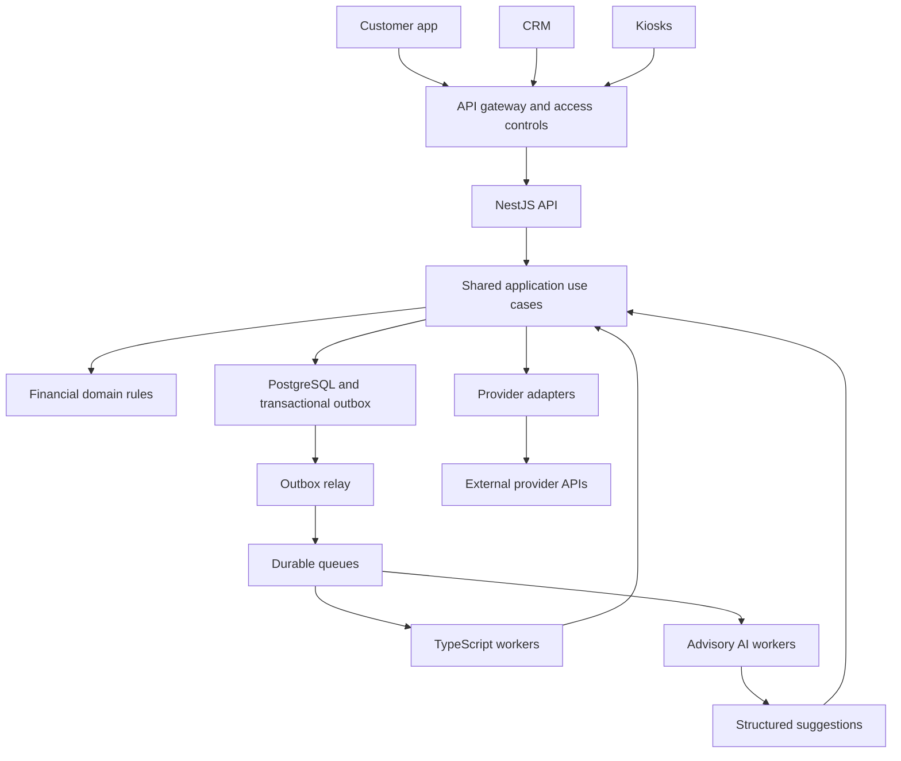

# Nukhbapay: Project Structure and Architecture

See the [catalogue module map](docs/catalogue-platform-structure.md) for the
current file locations and planned extension points across ingestion, pricing,
selection, publication and advisory intelligence.

13 November 2026 Brick 4A (ADR 0026): a pure application use case derives immutable versioned DRAFT catalogue candidates from exact accepted snapshots using existing bigint AED pricing. A separate unregistered 007 proposal persists only non-authorized candidate/source/idempotency/event evidence through a disposable restricted role and FORCE RLS. There is no activation, deployed/public read, new permission, live provider or payment path. Brick 3 operational trust remains a prerequisite for any future publication approval.

13 November 2026: ADR 0024 registers the reviewed migration 006 wrapper in source history after ADR 0023's checksummed, locked combined acceptance. Frozen 004/005 and both reviewed SQL sidecars remain unchanged. The guarded runner executes registered 001–006 only on verified random disposable targets; development remains 001–003. Only the IAM reader gains the necessary tokens_valid_after SELECT column, and no mutation credential is introduced. Normal runtime/session/provider modes stay disabled.

Brick 3C local follow-on (ADR 0022): apps/admin-web is now a minimal Node HTTPS BFF with explicitly served browser assets and no runtime framework dependency. Only internal synthetic acceptance composes opaque actors, fresh IAM/audit and isolated hash-only PostgreSQL sessions. Ordinary CLI startup has sign-in/sessions disabled. Migration 006 is registered source but unapplied to development; existing API modes, JWT trust and IAM/catalogue grants are preserved. See docs/security/staff-server-sessions.md for boundaries and limitations.

Naming follow-on (12 November 2026, ADR 0021): canonical project names are **Nukhbapay** / **nukhbapay**. The representative tree below uses the canonical logical name; the existing physical checkout locator is unchanged. Database schema, roles, custom settings, migration source and prior evidence retain their fixed names. See [naming compatibility](docs/naming-standardization.md).

**Design date:** 9 November 2026, Asia/Dubai  
**Stage:** local synthetic catalogue, staff foundation and global staff HTTP guards; real identity services unconfigured  
**Scope:** multi-provider product aggregation, controlled pricing and an advisory AI layer for a payment app, CRM and kiosks

Local lifecycle follow-on (11 November 2026): the common runtime explicitly composes synthetic verifier/IAM/guards, validates enabled dependencies before application initialization, exposes readiness only to trusted code and owns Nest startup/shutdown cleanup. Default mode is disabled; enabled mode requires `.invalid` issuer, injected synthetic transport and loopback services. Production/real provider activation remains blocked. No deployed route was added. ADR 0010 records the decision and limits.

## 1. Architecture decision

Approval-intake follow-on (12 November 2026, ADR 0020): an explicit default-deny intake port issues actor/proof/request-bound one-use tickets into the existing serializable synthetic persistence adapter. The existing blocked provenance-tagged review profile commits atomically with audit/receipt/outbox; purpose-bound reconciliation validates full persisted classification before disclosing a marker. No accepted approval, real MFA, APPLY, schema/grant change or deployed registration. Future accepted-approval/execution semantics require separately reviewed trust and later migration gates.

Internal read follow-on (12 November 2026, ADR 0019): the existing opaque actor boundary now composes a separate explicit synthetic workflow read policy with a restricted SELECT-only adapter. Owned operation/request/scope anchors separate requester and reviewer views; safe frozen projections and opaque bounded cursors prevent peer-evidence disclosure/enumeration. Each page uses one read-only repeatable snapshot and fresh IAM/policy checks plus committed audit. No deployed composition, schema/migration change, effective staff mutation, approval acceptance or operational MFA; normal IAM/catalogue credentials are unchanged.

Current persistence follow-on (12 November 2026): ADR 0018 registers a frozen local non-authorized migration 005 foundation with explicit backend grants and FORCE RLS. Existing opaque actor/policy and SERIALIZABLE store perform request/revision/review/provenance persistence with atomic audit/receipt/no-delivery outbox and authoritative recovery. No runtime registration, staff/grant mutation, accepted approval or operational assurance. Existing IAM/catalogue ACLs and deployed liveness-only routes remain unchanged; development is still 001–003. Rehearsal-only/persistence-unimplemented statements below describe earlier milestones.

Staff command contract follow-on: pure application contracts now describe immutable intent/audit/receipt bundles and future transaction ports. In-memory orchestration is test-only, retains all authorization blockers and records no staff state. Actual atomic persistence and execution remain unimplemented. See ADR 0012.

Staff lifecycle policy follow-on: pure application planning now describes typed lifecycle requests, independent approvals and proposed transitions. It neither executes commands nor claims authentication assurance. All results retain NOT_AUTHORIZED and current assurance/phase blockers. Database writers, atomic audit/receipts/outbox, real bootstrap and operational activation remain separate approvals. See ADR 0011.

Use one repository with separate runtime processes for the HTTP API, background workers and AI service. Keep reusable financial rules and use cases in backend packages.

The core backend is a modular application: catalog, pricing, quotes, orders, payments, ledger, reconciliation and device access have distinct ownership. A modular codebase can deploy its API and workers independently without turning every feature into a separate service.

The initial application technology is TypeScript/NestJS, with Python/FastAPI planned for the internal AI boundary. PostgreSQL is the authoritative data store. A durable queue handles background work; Redis may support caching and local queue experiments. Its exact queue role is a later decision.

The supplied financial and provider code remains a synthetic, offline foundation. A minimal NestJS API foundation now provides only `GET /health/live` on a loopback listener by default; it does not implement the production runtimes shown below.

## 2. Runtime architecture



The arrow from suggestions to core means controlled ingestion and validation. It does not grant AI direct database access or authority to publish prices. Model inputs are sanitized jobs on a separately restricted queue; AI cannot consume financial command queues. Financial commands remain in trusted application use cases.

The app, CRM and kiosks share pricing APIs. Their channel rules may legitimately differ; identical authorized pricing context must resolve consistently.

The diagram is target architecture, not a description of currently connected services. The common API factory installs global staff authentication/authorization guards with explicit trusted-code dependency ports. Default startup supplies no verifier or database connection and still registers only liveness; protected operations exist only in test bootstrap. Internal and HTTP identity acceptance use synthetic tokens and disposable PostgreSQL. No client, worker, AI or provider is connected.

## 3. Repository structure and ownership

```text
nukhbapay/
  apps/
    api/src/modules/
      identity/  catalog/  quotes/  orders/
      payments/  pricing-admin/  devices/  webhooks/
    worker/src/jobs/
      catalog-sync/  price-publication/  fulfillment/
      reconciliation/  outbox-relay/
    ai-service/
      src/nukhbapay_ai/
        schemas/  matching/  anomalies/  gateways/  api/
      prompts/  datasets/evaluation/  tests/
    admin-web/  kiosk-client/  mobile/
  packages/
    application/src/
      catalog/  pricing/  quotes/  orders/  payments/  ledger/  reconciliation/
    domain/src/  domain/test/
    provider-contracts/src/
    provider-adapters/src/  provider-adapters/test/
    contracts/public/  contracts/admin/  contracts/internal/
    database/migrations/  database/src/repositories/
  infra/local/  infra/deployment/
  docs/adr/  docs/security/  docs/runbooks/
  tests/integration/  tests/contract/  tests/security/
  scripts/
  README.md
  ARCHITECTURE.md
  package.json
  pnpm-workspace.yaml
  .env.example
```

| Path | Responsibility | Current state |
| --- | --- | --- |
| `apps/api/` | HTTP validation, authentication, authorization and dependency wiring | Liveness/bounded HTTP, synthetic-tested verifier and internal staff-self bridge; identity remains unwired to deployed routes |
| `apps/worker/` | Queue consumers, schedules, retries and worker wiring | Planned job boundaries |
| `apps/ai-service/` | Advisory matching, model gateway, extraction and anomaly jobs | Equivalence guard and fixtures implemented; model/HTTP integration planned |
| `apps/admin-web/` | CRM controls, exceptions, economics and reconciliation views | Planned UI boundary |
| `apps/kiosk-client/` | Customer kiosk UI and controlled device integration | Planned UI/hardware boundary |
| `apps/mobile/` | Existing app integration or greenfield customer app | Planned boundary |
| `packages/application/` | Reusable use cases and narrow ports | Catalogue import/read, staff policy/audit ports, opaque verified identity and audited internal self read implemented; downstream financial use cases planned |
| `packages/domain/` | Pure money, pricing and business invariants | Limited AED simulation implemented |
| `packages/provider-contracts/` | Normalized data and provider capability interfaces | Read-only catalog contract implemented |
| `packages/provider-adapters/` | Provider-specific transport and normalization | Synthetic read-only adapters implemented |
| `packages/contracts/` | Separate public, admin and internal DTO/event schemas | Initial schemas/examples supplied |
| `packages/database/` | Repositories, transactions and migrations | Catalogue 001–003 applied locally; restricted IAM-only runtime tested on disposable 004 databases, pending on development |
| `infra/` | Local dependencies and future managed deployment | Local container configuration supplied |
| `docs/` | Decisions, data model, build sequence and operations | Supplied |
| `tests/` | Reserved cross-module suite directories | READMEs; working API/application/domain/provider and PostgreSQL acceptance tests live beside their packages |
| `scripts/` | Offline demonstration and lightweight architecture checks | Implemented |

The complete actual inventory is in `docs/project-structure.md`. A directory containing only a README is an intentionally documented boundary, not an implemented module.

The 11 November recovery closes identical-import replay transactions before pooled connection release. Pending migration 004 removes automatic catalogue-role grants for new migrator-owned tables and explicitly denies catalogue roles all IAM table access; existing catalogue grants remain intact. Restricted-role, column-privilege, forced-RLS, default-grant and transaction-cleanup acceptance is recorded in `docs/verification.md`. This does not add API authentication, browser login, publication, or any financial execution.

### Code dependency rules

1. HTTP and worker entry points depend on shared application use cases.
2. Use cases depend on pure business rules and narrow provider/repository interfaces.
3. Database and external-provider adapters implement those interfaces.
4. Domain code has no database, network, queue, framework or model imports. The current sample imports only pure data types from provider-contracts.
5. Workers do not import API controllers or services from `apps/api`.
6. Client interfaces consume public/admin DTOs and presentation code; they do not import provider adapters, database entities or authoritative pricing functions.
7. AI does not import financial execution code or receive payment/provider/database credentials.

Explicit exports and future compiler/import-lint gates should enforce these rules. The supplied structure script catches a limited set of common accidental violations; it is not a complete security boundary.

## 4. API modules

| Module | Intended responsibility |
| --- | --- |
| identity | Verify identity and derive tenant, merchant, customer/session, device and staff permissions. |
| catalog | Read active published catalogs; apply availability/freshness policies and customer-safe serialization. |
| quotes | Validate transaction inputs and return authoritative, persisted, expiring prices. |
| orders | Consume accepted quotes with scoped idempotency; expose order ownership and status. |
| payments | Handle processor-specific authorization, capture, settlement and refunds. |
| pricing-admin | Manage versioned rules, approvals, simulations and private economic breakdowns. |
| devices | Enroll/revoke kiosks and enforce merchant/device limits and sessions. |
| webhooks | Verify external callbacks, deduplicate them and normalize provider events. |

Controllers handle transport concerns. Financial decisions belong in reusable use cases, allowing the HTTP path and background jobs to share the same rules.

### Planned endpoints

| Method and path | Caller | Result |
| --- | --- | --- |
| `GET /health/live` | Local process supervisor | Fixed process-liveness status only; checks no dependencies |
| `GET /v1/catalog` | App/kiosk/authorized CRM | Public catalog and display-price state |
| `POST /v1/quotes` | Authorized checkout | Persisted quote, breakdown and expiry |
| `POST /v1/orders` | Authorized checkout | Order created against accepted quote |
| `GET /v1/orders/{id}` | Order owner or permitted staff | Payment and fulfillment status |
| `GET /v1/admin/pricing/products/{id}` | Permitted staff | Provider economics, policy and audit history |
| `POST /v1/webhooks/{provider}` | Verified provider | Callback receipt and controlled processing |

These are design endpoints, not existing routes. The scaffold does not return fake successful payments or executable quotes.

## 5. Product and provider model

A canonical product describes the exact customer benefit. A provider offer describes one supplier's cost and conditions for delivering that benefit.

Do not compare two offers solely because their names are similar. Identity varies by category:

- Gift cards: brand, denomination, currency, redemption region, validity, mechanism and restrictions.
- Airtime/data: operator, country, benefit, validity and delivery mechanism.
- Bills: biller, actual customer bill, amount and partial-payment conditions.
- Tickets: same journey/date/time, passenger and fare conditions, inclusions and availability.
- Transfers: source/target currencies, amount basis, payout method, recipient eligibility and delivery conditions.

Normalize provider debit, separate fees, upfront/deferred commission, settlement currency, FX terms, validity and supported operations. Capture source snapshot ID, observed/effective time and completeness.

Provider capabilities must be explicit. Catalog access, bill inquiry, live quote, reservation, idempotent execution, status lookup and refund/cancellation cannot be assumed to exist for every provider. The current provider contract intentionally covers catalog reads only; extend it with separate capabilities when real providers are selected.

## 6. Financial authority and data handling

All customer charges come from controlled financial code. A model may suggest product attributes or anomalies but cannot authorize monetary changes.

The production pricing engine will maintain separate values for:
- Face value or transfer principal.
- Actual provider cost and fees.
- Already-netted versus separately receivable commissions.
- Payment collection costs.
- Agent/kiosk commission.
- Permitted service fee.
- Tax components and rounding rules.
- Expected contribution, with realized amounts tracked after settlement.

Use integer minor units for discrete posted currency amounts and exact numeric/decimal values for rates or higher-precision intermediate amounts. Currency metadata and contractual rounding rules determine precision. The runnable example supports AED only, using bigint internally and decimal strings at the boundary.

### Runnable synthetic calculation

Three offers represent one synthetic AE/AED 100 digital gift card. Provider A costs AED 97.00; provider B costs AED 96.50 plus AED 0.80; provider C costs AED 95.80 but is unavailable. A is selected.

The simulated customer total is AED 100.00 + AED 2.00 service fee + explicitly configured AED 0.00 tax = AED 102.00. At 1.5% + AED 0.20 collection cost and AED 0.50 agent commission, expected contribution is AED 2.77.

The embedded AED 3.00 provider discount is already in the AED 97.00 debit. It is not subtracted again. These values are illustrative and do not establish any actual fee or tax treatment.

The simulation checks identity, approved mapping, eligibility, availability, observation time, expiry, fee caps and minimum contribution. Its output explicitly says SIMULATION and executable=false.

## 7. Catalog refresh and price publication

1. A scheduler emits a provider-specific import job with tenant context and deduplication identity.
2. The connector retrieves a complete snapshot or explicitly marked delta within provider rate limits.
3. Retain appropriate source evidence, timestamps and a completeness marker.
4. Validate schema and normalize amounts and product attributes.
5. Reuse approved mappings; send ambiguous catalog metadata for advisory matching/review.
6. Compare eligible offers and calculate candidate prices with an approved rule version.
7. Quarantine invalid/stale/suspicious records and apply a documented completeness policy.
8. Commit an immutable publication, then activate its reference atomically.
9. Write an outbox event in the same transaction and notify/invalidate caches after commit.

An incomplete import must not imply deletion. An old provider update must not overwrite a newer one. A previous publication is usable only while its underlying offers remain valid; rollback cannot resurrect expired costs.

Daily refresh is the baseline. Volatile prices, availability and personalized bills need transaction-specific validation. A daily FX display rate does not create a guaranteed executable transfer quote.

## 8. Checkout and order workflow

1. The client submits product and transaction inputs to the quote endpoint.
2. The server derives tenant/customer/session/device/channel identity from verified authentication.
3. The quote use case validates product eligibility and retrieves a live provider quote or availability confirmation when required.
4. Financial code applies the permitted fees, payment method, taxes and rounding policy.
5. Persist an immutable quote with exact inputs, provider reference, rule/publication versions, calculated amounts and expiry.
6. Return only the public quote DTO. The client formats it for display.
7. The customer accepts the quote and submits an idempotent order request.
8. Validate ownership, unchanged inputs, expiry and consumption atomically; reserve/consume the quote according to the order state model.
9. Execute the rail/provider-specific payment and fulfillment workflow.
10. Resolve callbacks, record journals and reconcile settlement.

A submitted client amount is never the authority. Quote changes require renewed acceptance when the charge changes. Kiosks require a valid quote before cash intake and a defined recovery path for cash already accepted.

Keep payment state distinct from fulfillment state. A provider timeout after submission is UNKNOWN/PENDING. Resolve the original attempt using stable references and status/reconciliation before retrying or routing to another provider.

An idempotency key is scoped to an operation and authenticated owner. Reuse with a different payload must fail. Provider retries must follow the provider's actual support; internal deduplication alone cannot prevent every external duplicate.

## 9. Database and event design

The conceptual tables and ownership rules are in `docs/data-model.md`. The initial deployment can use one PostgreSQL cluster with distinct schemas, roles and module-owned access paths.

Core records include products/mappings, provider offers and snapshots, versioned policies, publications, quotes, orders, payment attempts, fulfillment attempts, journals, entries, settlements, reconciliation cases and audit events.

For tenant-owned records, include tenant identity in references or equivalent enforced constraints. Do not rely on a client-supplied tenant filter. Staff access, worker provenance and cache keys must preserve scope. Global reference products can be separate from tenant-owned contracts and offers.

Write outbox events together with state changes. An outbox relay delivers them to durable queues; consumers transactionally record inbox deduplication and their changes. Delivery may repeat. No end-to-end exactly-once guarantee is assumed.

Ledger entries are append-only, journals balance per currency, and corrections use controlled reversals or adjustments. FX transactions need explicit currency legs and configured rates. Provider discounts, deferred commissions, reversals and actual settlement remain distinguishable.

## 10. Advisory AI architecture

The AI runtime receives sanitized catalog jobs. It proposes structured matches, extracted metadata or anomaly observations. A controlled backend use case validates and accepts/rejects the suggestion.

The starter contains:
- Strict stdlib Python contracts.
- A deterministic equivalence guard for gift-card and prepaid-airtime records.
- Ten synthetic positive/negative evaluation cases.
- A future model-gateway protocol and unexecuted prompt draft.
- Provenance fields, hard negative handling and can_publish=false outputs.

It does not call a model or start FastAPI. Future semantic matching can shortlist candidates using embeddings and request structured extraction from an approved model. Validate output schema and hard attributes, then calibrate automation using reviewed evaluation data. Model self-confidence is not sufficient to authorize a mapping.

Record job/tenant/correlation IDs, snapshot/catalog version and rules/model/prompt version as appropriate. Treat descriptions as untrusted data. Do not send credentials, unnecessary personal information or payment details.

Model/API outages do not block known approved mappings or checkout. Financial rule extraction from provider documents remains proposed data until approved and versioned.

## 11. Security and operational boundaries

- Verify authentication before deriving tenant, merchant, customer, channel or device context.
- Enforce authorization for every quote, order and admin object, and serialize public/admin responses separately.
- Give workloads separate identities. Keep provider credentials in secret storage and restrict outbound destinations.
- Validate provider schemas and callback authenticity; reject replay and duplicate application of financial events.
- Limit price-rule changes, approvals, refunds and reconciliations to appropriate roles; audit each change.
- Give every kiosk a revocable device identity and managed security updates; clear customer sessions and local sensitive data.
- Keep AI outside the financial trust boundary.
- Use private data services, encryption, backup restoration tests and protected deployment pipelines.
- Keep logs and traces useful through correlation IDs without retaining unnecessary customer or credential data.

The API foundation implements validated local listener configuration, bounded JSON parsing, finite HTTP timeouts, generic HTTP errors, process-only liveness and global deny-by-default staff guards. Guards reuse the existing verifier, exact issuer/subject resolver and audited self-only application operation. Only the exact reviewed GET health handler is public; permission metadata and required dependencies are mandatory for protected operations. A test-only controller proves the boundary without adding deployed staff/business routes. Real identity trust/runtime composition remains unconfigured; the other controls above are requirements rather than production guarantees. Production scope depends on launch jurisdiction, payment rails, funds ownership, provider agreements and kiosk cash/card behavior.

## 12. Technology and bootstrap decisions

The pnpm workspace is a repository organization choice. It is not the same as requiring Nest's own workspace generator. Use separate Nest application packages wired to shared libraries. Python dependencies remain independently managed.

The offline examples need no external dependencies. The API bootstrap uses Node.js 24.22.2, pnpm 10.34.9 via Corepack, NestJS 12.4.2, Nest CLI 12.0.12, and TypeScript 6.0.2. Exact direct API dependencies and the workspace dependency graph are recorded in `apps/api/package.json` and `pnpm-lock.yaml`; strict compiler settings are isolated in the API package. The worker has no runtime implementation or dependencies. Dependency review and future vulnerability checks remain separate maintenance tasks.

Local Compose defines optional PostgreSQL and Redis services. It does not apply migrations or start the application. Production deployment is intentionally unprovisioned until region, identity and provider requirements are known.

## 13. Build order

Brick 2B's local synthetic complete-snapshot persistence and internal reads
are complete within the tested scope. Brick 3A's provider-independent staff
identity records, scoped authorization foundation, forced tenant RLS, and
bounded audit persistence are also complete within their local synthetic
acceptance scope. Brick 3B-1 adds synthetic-tested token validation, 3B-2
adds restricted internal IAM/self authorization, and 3B-3 adds global HTTP
guards with test-only acceptance. No browser login, staff/grant management
workflow or deployed business route is implemented. The project stops after
the authorized 3B-3 increment. Real-provider/runtime activation needs separate
approval; do not start price publication or customer catalogue endpoints
before Brick 3 is complete. Brick 4 is controlled price publication and an
authorized catalogue API.

Auth0 is conditionally preferred for a staff-only non-production pilot, with
region/residency/commercial and operational decisions pending. No real issuer,
API audience, client or external identity service is configured. See
`docs/adr/0005-trusted-identity-provider.md` for the decision record and
`docs/build-sequence.md` for the bounded increments and acceptance conditions;
ADRs 0007–0009 describe local verifier, IAM and guard decisions.
Quotes, provider integrations, and money movement remain later, separately
scoped increments.

## 14. Reference documentation

These sources support the technical building blocks; the architecture itself is a project recommendation.

- [NestJS modules](https://docs.nestjs.com/modules)
- [pnpm workspaces](https://pnpm.io/workspaces)
- [FastAPI application structure](https://fastapi.tiangolo.com/tutorial/bigger-applications/)
- [Node.js native TypeScript and type-checking limitations](https://nodejs.org/api/typescript.html)
- [PostgreSQL exact numeric types](https://www.postgresql.org/docs/current/datatype-numeric.html)
- [Temporal activities and idempotency](https://docs.temporal.io/activities)
- [Stripe idempotent requests](https://docs.stripe.com/api/idempotent_requests)
- [Stripe webhook behavior](https://docs.stripe.com/webhooks)
- [OWASP API security](https://devguide.owasp.org/en/07-training-education/07-api-top-ten/)
- [OWASP prompt injection guidance](https://genai.owasp.org/llmrisk/llm01-prompt-injection/)

Provider and technology documentation was reviewed for this architecture on 9 November 2026. Actual versions, contracts and dependencies must be verified during their implementation.
