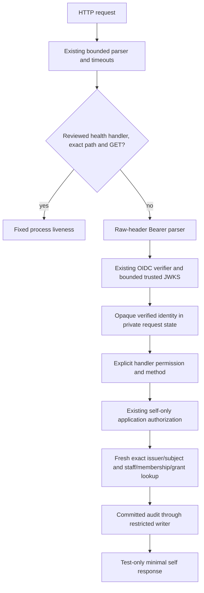

# ADR 0009: Global staff HTTP guards with test-only acceptance

Status: implemented for the authorized local Brick 3B-3 increment
Date: 11 November 2026

Follow-on: the separately authorized local lifecycle increment (ADR 0010) now owns explicit synthetic composition, internal readiness and startup/shutdown cleanup. The original 3B-3 scope/evidence below is historical; real provider activation and deployed staff endpoints remain unapproved.

## Scope and composition

Install authentication followed by authorization as global HTTP guards in the common Nest application factory. Keep the deployed `AppModule` unchanged: its only controller is process liveness. The staff controller lives exclusively under `apps/api/test/fixtures`, is registered only by test bootstrap, and is excluded from production compilation. No public staff/business endpoint, browser login, provider setup, migration or permission activation is authorized here.

The factory accepts explicit trusted-code verifier, repository, audit-writer and clock dependencies. It never selects test modules or bypasses from environment variables, request values or a runtime test-mode switch. Default startup has no configured identity services and opens no database pools: health remains live, while any added protected handler fails closed. Missing credentials produce 401; syntactically present credentials without a verifier, or verified identity without required IAM ports, produce 503. This is local boundary infrastructure, not enabled real-provider authentication. Later operational wiring requires its own bounded approval.

Every failed verification, policy denial or required dependency failure ends the request before the handler. Unmatched paths return sanitized 404 and reveal no private data. The acceptance module supplies synthetic identities and restricted disposable-database ports only.

## Public routes and permission metadata

`PublicRoute` is a marker, not sufficient authority to exempt a route. The reviewed exemption checks the exact `HealthController` class and `getLive` handler, raw path `/health/live` and method GET. Query strings do not affect the fixed liveness response. Case/trailing-slash aliases are not registered: Express case-sensitive/strict settings are applied before the adapter initializes its router. No other public marker is honored. HEAD does not inherit public GET status.

Protected handlers require method-level `RequireStaffPermission` metadata: explicit permission code, scope and approved GET method. There is no class-wide default, wildcard, implicit administrator or permission inferred from URL, identity claims, headers or roles. Missing metadata and implicit HEAD mappings call the existing policy with no permission, obtain a denial audit where available, and return 403 for an authenticated identity. Alternate explicitly registered methods cannot inherit GET authority. OPTIONS returns generic 404 before Express can synthesize an Allow response; no CORS/browser flow is introduced. Method-override headers are ignored.

The decorator permits GET only in this increment. The application operation additionally permits only `staff.self.read` in SELF scope even if a later policy were expanded. All reserved permissions remain inactive. Aliases of a protected handler execute the same guards. Future permission/method activation and public exemptions require separate review.

## Identity, scope and audit

Authentication invokes the existing bounded raw-header parser and provider-independent verifier exactly once. It does not decode claims independently or duplicate cryptography. Only original opaque verified identities are accepted; structural/JSON substitutes fail closed. Module-private WeakMaps hold per-request verified identity and allowed self result, cleared before authentication. `req.user`, identity/tenant headers, cookies, query/body fields and token role/permission claims cannot populate this state. There is no positive authorization cache.

Authorization calls the unchanged `readAuthorizedStaffSelf` operation and Brick 3A policy. Exact issuer/subject binding, current active staff and identity, selected tenant membership and object ownership, grant lifecycle, and no platform-to-tenant inheritance remain server-side checks. A trusted context resolver may identify a requested tenant but must obtain object ownership from trusted application data. The test resolver deliberately fixes object ownership independently of the requested tenant, proving a second active membership and forged tenant claims do not override ownership.

The handler sees only the minimal authorized self result after audit transaction commit. Database lookup or allow-audit persistence failure returns 503 without executing the handler. Already-denied requests remain denied with 403 if their audit cannot be persisted, following ADR 0008; the guard emits a fixed warning without identity, token, URL or exception detail. Invalid credentials never reach IAM. Authentication-attempt monitoring, audit retention/export and operational alert delivery remain pending rather than being claimed as implemented audit coverage.

## Errors and resource bounds

Missing/invalid/unapproved credentials return generic 401 with `WWW-Authenticate: Bearer`; application denials return generic 403; invalid internal UUID context returns generic 400. Required JWKS/verifier/IAM failures return fixed 503. Unmatched paths and OPTIONS return generic 404. Errors and protected responses use `Cache-Control: no-store`. Raw dependency exceptions are discarded without causes; framework/application logs contain fixed messages only. The response does not distinguish unknown from suspended staff or disclose issuer, subject, email, tenant details or bearer values.

The existing 16 KiB strict JSON limit, compressed-body rejection, header cap and HTTP timeouts are preserved. Parser errors may reject before guards (400/413/415), without executing a protected handler. Trusted JWKS and restricted database timeouts remain unchanged. This increment does not add production TLS, rate limiting, ingress/egress controls or a session system.

## Acceptance and remaining limits

Non-destructive HTTP tests use ephemeral library-generated signing keys and synthetic issuer/key transport. Separate HTTP integration uses actual restricted IAM connections on a verified uniquely generated disposable target, with fixture administration confined to setup/cleanup. Tests cover public health, unknown paths, missing/malformed/duplicate/oversized/forged/expired/wrong-profile credentials, aliases/methods, missing permissions, fresh status/membership changes, object scope, inactive grants/reserved permissions, missing ports, identity provenance, outages, committed audit and log/response redaction. Existing verifier rotation/invalid-key/unavailable-JWKS tests and full catalogue/IAM/financial/advisory regressions remain required. Commands, actual results, targets and resolved development failures are recorded in `docs/verification.md`.

Real Auth0 issuance/profile/MFA and provider integration are unverified. Default identity services are unconfigured. Migration 004 remains unapplied to `nukhabapay_dev`; no database code, migration, role grant or permission catalogue changes here. Local PostgreSQL trust authentication is unchanged. Reader lookup and writer audit are separate transactions, so a concurrent status change after the lookup is not serialized with a future sensitive action. Such actions require a separately reviewed consistency design. A compromised trusted application/adapter is outside the opaque type and custom tenant-GUC defense.

All applicable management decisions remain PENDING. Completing this local increment does not approve deployment, external services, real staff onboarding, non-disposable migrations, further endpoints, Brick 3C or Brick 4. Stop after Brick 3B-3.

## Framework sources reviewed

- [Nest global guards and execution context](https://docs.nestjs.com/guards)
- [Nest authorization and Reflector metadata](https://docs.nestjs.com/security/authorization)

The installed pinned Express/Nest adapter source was also inspected to confirm router-setting initialization order. No dependency upgrade or custom JWT cryptography was introduced.
