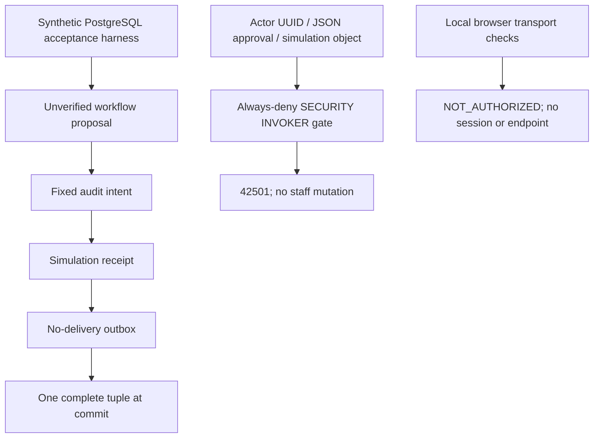

# ADR 0013: Local persistence rehearsal with a closed execution gate

12 November 2026 follow-on: ADR 0018 registers a self-contained restricted non-authorized migration 005 snapshot, including these four compatibility tables. The pending source and historical evidence below remain preserved. Workflow tests now use actual registered migration history; privileged execution and all original trust gates remain BLOCKED.

Date: 11 November 2026

Status: implemented for the limited local rehearsal below. Privileged staff persistence and operational activation are BLOCKED.

The owner authorized safe synthetic Brick 3 and Brick 3C progress subject to explicit security gates. This supersedes earlier stop-after-planning text; it does not approve provider setup, real identities, development migration, reserved runtime permissions or financial operations. ADRs 0005–0012 retain their security boundaries.

## Implemented architecture

`packages/database/pending-migrations/005_staff_access_workflows.sql` is executable rehearsal SQL, deliberately outside the registered migration directory. It is NOT the complete privileged migration 005 and must not be promoted as such. The disposable harness first runs registered migrations 001–004, then executes this candidate on one migrator connection in BEGIN/COMMIT after checking the actual generated database name. It inserts no 005 migration-history row. No application startup loads it.

The four logged tables are `iam_workflow_proposals`, `iam_workflow_audit_intents`, `iam_workflow_receipts` and `iam_workflow_outbox`. UUID staff/tenant references, fixed operation/event/outcome/action checks, 64-character hexadecimal operation/digest checks, unique actor/key namespace and composite actor/target/scope/digest foreign keys prevent substitution. A generated event name binds each audit intent to the proposal operation. Immediate forward foreign keys enforce insertion order. A deferred proposal-to-outbox foreign key rejects a commit missing any member of the tuple. Update/delete rejection triggers and absence of UPDATE/DELETE/TRUNCATE grants protect recorded history.

All proposals are UNVERIFIED, SIMULATION_ONLY and NOT_AUTHORIZED. Receipts are SIMULATION_RECORDED; outbox records are NO_EXTERNAL_DELIVERY. They do not represent staff mutation, verified approval, a delivered notification or a committed staff security audit. No real audit vocabulary or writer grant changes.

## Exact candidate privilege matrix

| Principal | Four workflow tables | Command function | Existing IAM/catalogue |
| --- | --- | --- | --- |
| PUBLIC | None | None | Unchanged |
| Catalogue runtime/importer | None | None | Existing restricted grants unchanged |
| IAM reader/audit writer | None | None | Existing restricted grants unchanged |
| Migrator/owner | Ownership, DDL; FORCE RLS on normal DML | Owns SECURITY INVOKER deny-only function | Migration role only; never application execution |
| Ephemeral disposable test recorder | Explicit SELECT/INSERT only; FORCE RLS | Explicit EXECUTE, always raises 42501 | Schema USAGE only; no staff/audit writes, no staff reads, no schema CREATE |

No persistent command role, role membership, application credential, SECURITY DEFINER function or privileged table grant is introduced. The generated recorder is NOSUPERUSER/NOCREATEDB/NOCREATEROLE/NOINHERIT/NOBYPASSRLS, exists only for acceptance and is explicitly removed before the disposable database is dropped. The candidate revokes inherited/default table exposure from all four workload roles and PUBLIC, and PUBLIC function EXECUTE within the same DDL transaction.

`workflow_scope` is a transaction-local accidental-scope guard, NOT identity proof: any client able to use the recorder credential can set it. Therefore that role is prohibited in runtime, has no staff authority and stores only untrusted artifacts. A future privileged design cannot authorize from this GUC. FORCE RLS does not constrain superusers/BYPASSRLS; test administration is fixture-only. Refer to PostgreSQL [row-security semantics](https://www.postgresql.org/docs/current/ddl-rowsecurity.html) and [function security](https://www.postgresql.org/docs/current/sql-createfunction.html).

## Execution gates and trustworthy provenance

The existing token boundary supplies exact approved issuer/subject, approved human-client evidence and fresh server-side staff resolution. It deliberately emits `assurance=not-established`; it supplies NO sensitive-action assurance. A UUID, email, request header, client approval JSON, simulation receipt, digest or environment flag is never authority. The SQL gate rejects them all; existing pure lifecycle policy still cannot APPLY.

Before any privileged implementation can execute, all of these gates must pass:

1. An approved verifier/assurance adapter must demonstrate authentic provider-signed human identity and fresh strong authentication evidence, expected audience/client, factor semantics, authentication time, bounded age and revocation policy. `amr`/`acr` labels alone do not establish the actual provider guarantee. Production trust, real MFA policy and accountable owners remain management decisions.
2. Approval records must be created by separately authenticated approvers, resolved to canonical underlying staff people, bound to an immutable request digest, exact scope/role/version, expiry and one-time approval slot. The server must verify each approver's current independent authority and assurance; requester, target and duplicate identities of one person cannot meet independent quorum. Caller-supplied approval data must never be accepted as provenance. The synthetic planner is not this adapter.
3. A restricted executor must consume only such trusted evidence and recheck it atomically with current staff/membership/grant/request/approval versions. It must not accept freely selected actor identity on a database command connection. Shared DB credentials authenticate a workload, not a human. The trusted handoff and its forgery/replay/expiry tests are not implemented and are BLOCKED, not simulated into authority.
4. Only after these gates and local disposable acceptance may an immutable, reviewed privileged migration replace the pending candidate. Any SECURITY DEFINER function requires an isolated NOLOGIN/NOBYPASSRLS owner with explicit minimum grants, no runtime membership/SET ROLE path, fixed safe search_path, qualified objects, no dynamic caller SQL, revoked PUBLIC/default EXECUTE and tested RLS. Ownership of IAM tables must not be used as an authorization bypass. No such function is present now.

## Required privileged schema and transaction changes (not implemented)

The full migration needs immutable versioned access requests, independently authenticated approval evidence and canonical-person uniqueness; a bootstrap singleton with separately recorded owner authority; staff/membership authorization-version counters; scheduled grant/revocation records; actual mutation audits, receipts and delivery outbox. Request/approval constraints must bind actor, target, person, scope, role, digest, version, deadline and permitted state transitions. A future-grant cancellation must not be forced into migration 004's `revoked_at >= granted_at` constraint: distinguish cancellation time from effective revocation time and define validity as start <= decision time < end, excluding cancelled grants. No existing grant constraint is changed here.

The executor must use one checked-out connection and one SERIALIZABLE transaction for idempotency reservation, locked fresh authorization/approval reads, CAS versions, staff mutation, success audit, final receipt and required outbox. Fix lock order: actor/key reservation, canonical staff IDs sorted, membership IDs sorted, grant/request/approval IDs sorted. Never acquire network/provider locks inside the transaction. Retry only whole transactions for 40001/40P01 with bounded attempts and fresh authority/expiry checks; a unique-key conflict requires receipt comparison, not blind execution. Reject changed payloads under the same actor/key.

On COMMIT connection loss, return UNCERTAIN without a success receipt and discard the connection. Reconcile on a fresh restricted receipt lookup using exact actor/key/digest/scope; absence is not proof of rollback. Reacquire serialization before any retry. The existing deterministic model tests these semantics; the PostgreSQL rehearsal proves tuple durability/rollback and uniqueness only. It does NOT prove atomic real staff mutation, authenticated receipt lookup, executor deadlock retries, process-kill acknowledgement recovery, outbox delivery or backup restore. Those remain implementation acceptance gates.

## Safe Brick 3C progress

`staff-browser-security.ts` implements only local `.invalid` HTTPS origin/CSRF checks, bounded duplicate-sensitive header parsing, host-only secure HttpOnly Strict cookie options, and server-metadata idle/absolute/revoked lifetime checks. Even a passing transport result is NOT_AUTHORIZED. No cookie/session is issued, no endpoint is registered and no identity is established. Local 8-hour absolute/15-minute idle limits are synthetic test policy, not approved operational objectives.

Browser login, supported BFF SDK selection, exact callbacks, real MFA, session encryption/storage/revocation, hosting and recovery ownership remain BLOCKED on the applicable management/trust gates. There is no custom OIDC or token cryptography. The deployed API remains GET /health/live only.

## Acceptance and completion limits

Real disposable PostgreSQL tests cover scope denial, complete tuple commits, rollback after every staged write, failed incomplete commit, unique-key concurrency, changed payload rejection, mismatched audit bindings, forged authority denial, restricted direct IAM/audit access, fixed function security and unchanged workload grants. Existing verifier, policy, HTTP, runtime cleanup, catalogue and financial regressions remain required. Exact results and targets are in verification.md.

This increment completes a local non-authorized persistence rehearsal and partial Brick 3C transport foundation. Brick 3 overall, privileged staff persistence, real onboarding and operational authentication are NOT complete. Continue independently safe local work through executable tests, without inventing approval evidence or opening the gate. The subsequently authorized connection-loss acceptance is recorded below; actual privileged execution remains BLOCKED until the trust gates above are demonstrably satisfied.

## Follow-up: database failure-recovery acceptance

11 November 2026. The owner authorized only failure/reconciliation acceptance for NON-AUTHORIZED artifacts, followed by review. Test-only fixtures now exercise actual PostgreSQL connection loss before COMMIT, at two wire boundaries during COMMIT acknowledgement, and after confirmed COMMIT. No migration SQL, workload privilege, production adapter or endpoint changes.

The loopback proxy parses bounded protocol frames without logging payloads. It either disconnects before forwarding COMMIT or forwards it and drops PostgreSQL's COMMIT command-complete response before the client receives it. Both yield UNRESOLVED from the acknowledgement helper, with no operation/receipt returned. A fresh primary connection subsequently discovers NOT_COMMITTED or COMMITTED respectively. This is real TCP loss around real PostgreSQL transactions, not an in-memory commit simulation. It is not a server crash, WAL/storage failure, replication failover or restart/restore drill.

The fixture-only reconciliation protocol reserves a transaction-scoped advisory lock on the stable actor/key namespace before reading the authoritative persisted receipt. Nonblocking reservation failure means UNRESOLVED, even if an ordinary read would see no uncommitted row. READ COMMITTED gives a fresh snapshot after lock acquisition. NOT_COMMITTED means no complete receipt at that serialized observation point under the fixture's mandatory reservation protocol; it is not proof that a disconnected COMMIT failed merely because a prior lookup was empty. Retry reacquires the same key, compares exact payload, and either returns the existing receipt or stages one complete tuple. Existing unique and deferred complete-tuple constraints remain the final database guard. There is no new arbitrary-key retry or privileged action.

COMMITTED means a committed SIMULATION_RECORDED receipt only. Every outcome remains NOT_AUTHORIZED. CONFLICT and DENIED contain no operation identifier/receipt. Lookup connection errors/timeouts return UNRESOLVED without a success object. Three retries over independent connections converge on one operation; all four tables remain one row per operation. Changed payloads conflict. Failed/aborted/disconnected connections are closed rather than returned to a pool; tests check terminated backend disappearance, absence of idle transactions, healthy reconnect/retry and existing fixture zero-session teardown.

Receipt lookup is deliberately test-only. A private bootstrap-bound capability selects one fixed synthetic actor/tenant; request UUIDs, structurally identical/cloned objects and another tenant/actor are rejected before lookup. The parameterized query binds actor, key and scope; existing RLS is also exercised on populated tables. This is not a real authenticated session or approver credential. The recorder DB credential alone can read untrusted artifacts within any scope it selects; **database RLS does not enforce human actor identity**. It must never be issued to users or wired into runtime. Existing IAM/catalogue roles still have no workflow access. Real authenticated actor-scoped receipt access and privileged recovery remain BLOCKED on the earlier trust gates.

Acceptance and exact commands/targets are in verification.md. This closes only the bounded local non-authorized failure-recovery task. Stop for owner review; no additional increment is started automatically.
