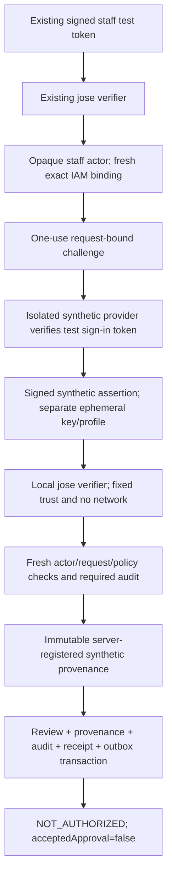

# ADR 0017: Actor-bound synthetic assurance and non-authorizing approval provenance

12 November 2026 follow-on: ADR 0018 includes a self-contained copy of this provenance schema in registered restricted migration 005 and tightens null-sensitive tenant binding. Original pending SQL is preserved; acceptance now uses actual 005 and an explicit optional synthetic backend grant. No change to assurance, approved runtime permissions, provenance authority or privileged execution gates.

Date: 12 November 2026

Status: implemented for isolated local synthetic verification and disposable PostgreSQL acceptance. Independently authenticated privileged approval acceptance and operational MFA remain BLOCKED.

The owner authorized one bounded Day 4 implementation, not a new planning phase or permission activation. ADR 0016 request/review behavior, existing token assurance and all execution gates remain intact.

## Implemented trust flow

Only the existing verified-identity/opaque-actor boundary issues challenges or provenance. Actor handles, challenge objects and provenance have private instance-local registries; client JSON, UUIDs, headers, structural clones, other boundary instances and another actor cannot substitute. No JSON rehydration or generic attestation constructor exists for these proofs.

An immutable binding includes canonical staff ID, exact verified issuer/subject, request ID/version/digest, tenant (including null platform scope), lifecycle policy version and current authority digest. Challenge IDs are standard crypto random UUIDs; the digest uses standard SHA-256 over the fixed binding/nonce/time tuple, not a signature or custom JWT cryptography. Deadline is at most sixty seconds and bounded by the original token/request expiration. Integer-second rounding is explicit for JWT timestamps. Used challenges cannot be verified again; concurrent verification cannot mint two proofs from one challenge.

Before issuance, verification and persistence, fresh identity/staff/membership/grant checks and current request lookup revalidate the binding. Requester/beneficiary participation denies. Eligibility uses the unchanged role policy plus explicit local recording capability; reserved permission denial is not converted into an approval ALLOW. Platform grants do not confer tenant authority. A request revision, actor authority change, expired evidence or substituted scope invalidates provenance. Required audits must commit; failures cannot mint provenance or return a successful review.

## Isolated assurance contract

`SyntheticAssuranceVerifier` is an explicitly LOCAL_SYNTHETIC_ASSURANCE_ONLY port. No adapter is configured by default or registered in deployed runtime. Existing `VerifiedStaffIdentity.security.assurance` remains exactly `not-established`; operational sensitive actions do not consume the synthetic type.

`LocalSyntheticAssuranceVerifier` uses the existing pinned jose 6.2.17, RS256 and a copied local public-key set of one to three RSA signing keys. No private keys, token-provided keys/URLs, external JWKS, redirects, network discovery or Auth0 configuration. Constructor requires test mode. Exact issuer is `https://assurance.synthetic.invalid/`, audience `urn:nukhabapay:synthetic:approval-provenance`, token type `synthetic-assurance+jwt`, profile `synthetic-approval-provenance-v1`. Staff API access/ID tokens cannot substitute.

Assertions are bounded to 8 KiB. Required signed claims include challenge ID, full binding digest, subject, authentication-event UUID, issue/expiry/authentication times, exact profile and synthetic=true. Audience arrays, unknown headers/claims, mfa/amr/acr flags, unknown signing keys, wrong algorithms/signatures/profiles, missing/time-invalid claims and rebinding reject. No clock tolerance or real MFA interpretation. Only validated metadata/digests leave verification; raw assertions/access tokens appear in neither actor/provenance results nor persisted records/logs. The fixture provider's protocol response exists only in test memory.

The fixture provider owns an ephemeral private key and re-verifies the staff test access token, exact issuer/subject, human profile and issuance freshness before signing the challenge response. It demonstrates a separate local verification/signing event, **not a second real factor, real human interaction, independent device, actual MFA ceremony or Auth0 assurance**. It can reuse a bearer credential within the synthetic challenge's issued second; a synthetic response must never be marketed as independent operational authentication. Fault-signing helpers exist only under tests, never production packages.

Verified synthetic provenance is frozen with its frozen binding, challenge/event IDs, provider/key ID, issue/expiry times, assertion digest and record digest. It permanently carries synthetic=true, operationalAssurance=not-established, acceptedApproval=false and execution=NOT_AUTHORIZED. Authentication-event replay is bounded by a process-local, expiry-pruned registry (maximum 1024 active events), and durable event uniqueness independently prevents cross-instance replay. A proof binds to one canonical command key; same-key persistence retry is allowed while current/fresh, changed keys deny. Evidence expiration does not authorize renewed execution; existing own-receipt lookup can reconcile a committed record without rehydrating proof authority.

## Durable provenance and compatibility

`pending-migrations/synthetic-approval-provenance.sql` is additive disposable-only DDL, not a registered migration or a development change. Original migrations and ADR 0016's schema file are preserved. A new immutable RLS-protected `staff_synthetic_provenance` table stores safe binding/evidence metadata, never the raw JWT. Composite foreign keys bind it to exact review actor/request/version/scope/digest/authority and exact operation issuer/subject. Challenge/event UUIDs are unique. The markers forbid operational assurance or accepted approval values.

A nullable operation pointer plus deferred foreign key makes provenance mandatory for a provenance-tagged review commit; no partial tagged review may commit. Provenance is inserted on the same connection/transaction as review, fixed audit event, receipt and no-delivery outbox. The command digest includes provenance digest, so stripping/substituting evidence conflicts on replay. Existing independent-person uniqueness still rejects alternate identity participation. Same-key identical proof retry returns the original receipt; uncertain commit is resolved with fresh actor-bound lookup. Nothing changes request state to APPROVED/APPLIED or creates a privileged approval audit.

The store extension is explicitly disabled unless LOCAL_SYNTHETIC_ONLY is selected. Existing plain observations remain valid non-authorized observations and require no fake MFA; they cannot satisfy an approval quorum. The new fixture uses a separate generated restricted request-backend role, not yesterday's role or existing IAM/catalogue credentials. It has SELECT/INSERT on the seven synthetic artifact tables and the same minimal IAM column reads/select-only tenant policies from ADR 0016. No staff writes, contacts, schema/role management or command execution. Old roles receive no provenance access. Scope policies and all generated role grants are removed at teardown. No SECURITY DEFINER function or operational role is introduced.

SQL credentials authenticate the trusted backend, not the human. Stored records are an attestation of local verification under that trusted adapter, not an independently verifiable operational MFA archive: ephemeral keys are fixture-only, raw signed assertions are deliberately absent, and no persisted DTO becomes an actor or proof after restart. A compromised trusted adapter/provider remains outside the untrusted-client threat boundary. Final fresh reads do not make future privileged mutation globally atomic; ADR 0016's remaining race/execution gates still apply.

## Verified and blocked outcomes

Locally functional: issue scoped challenges, cryptographically verify signed synthetic responses, bind immutable server provenance to exact actors/requests/authority, reject forged/replayed/stale/cross-scope evidence, atomically persist provenance with non-approved review history, and reconcile uncertain storage without duplicates. Tests use real ephemeral signatures and real disposable PostgreSQL, not simulated cryptographic success.

Blocked: independently authenticated accepted privileged approvals, operational MFA, approval/quorum activation, APPROVED/APPLIED state, reserved permissions, effective staff/membership/grant mutation, Auth0/real accounts, runtime registration, deployed endpoints and development migrations. Reasons: the approved staff token profile establishes no MFA; the isolated fixture is not an approved operational issuer/factor/recovery ceremony; production trust/ownership remain PENDING; approval permissions intentionally remain inactive; no privileged executor is enabled. Synthetic evidence does not remove any blocker. Brick 3 overall is incomplete.

Actual commands, database/privilege cleanup, startup recovery, results and changed files are in verification.md. Stop after this bounded implementation for owner review.
