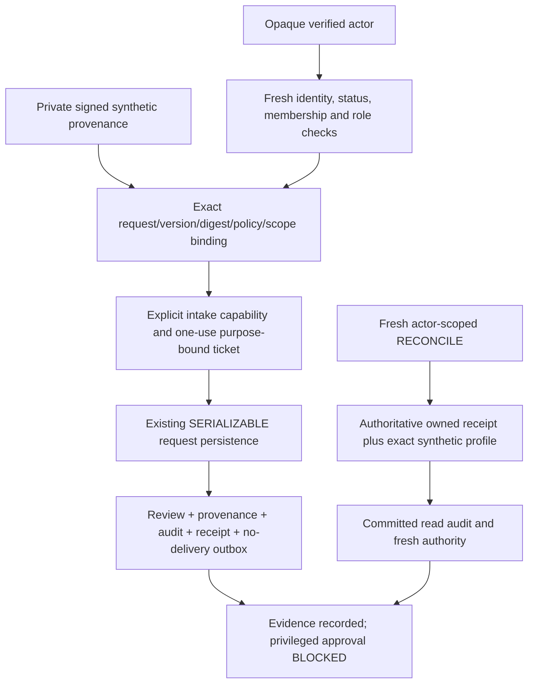

# ADR 0020: Gated staff approval intake with blocked synthetic evidence

Date: 12 November 2026

Status: implemented for internal local synthetic acceptance only. Accepted privileged approvals, operational MFA, APPLY and effective staff changes remain BLOCKED.

The owner authorized one functional intake increment after ADR 0019. It reuses the actor, signed synthetic provenance, request/review and migration 005 foundations. No schema/migration, grant, deployed registration, real provider or financial change.

## Operation and trust flow

`TrustedStaffActorBoundary.intakeStaffApproval` accepts an existing opaque actor, a strict ATTEMPT command and same-boundary verified synthetic provenance. RECONCILE is a separate command kind for historical evidence lookup and accepts no supplied proof. Both require the explicit default-deny `NON_AUTHORIZED_STAFF_APPROVAL_INTAKE` port. Existing request/read/self permissions or ports do not implicitly grant intake.

Exact verified issuer/subject resolution binds the canonical underlying staff person. Staff/identity must remain active, tenant membership exact/active, token current and authority fingerprint unchanged. Existing authorizeStaffAccess validates grant time, scope and conflict eligibility; only PERMISSION_INACTIVE role eligibility is accepted, never activation of reserved permissions. Platform grants cannot supply tenant authority. The separate explicit port policy must independently allow ATTEMPT or RECONCILE. Trusted issuer remains `.invalid` and storage remains a verified disposable target.

Only six input fields exist: kind, UUID key, UUID request id, bounded bigint version, immutable request digest and fixed lifecycle policy version. The normalizer copies/freeze them and rejects unknown authority/MFA/receipt fields, foreign prototypes and accessors. There is no ACCEPT/APPLY, actor ID, tenant claim, approval JSON or client MFA flag input. Provenance is a private instance-registered object from the existing verifier/challenge flow, not deserialized claims, a simulation receipt, a raw token/assertion or a structural copy.

ATTEMPT checks exact proof actor, issuer/subject/canonical person, request/version/digest/policy/tenant, current roles and authority, request head/expiry, evidence lifetime and key binding. Requester/beneficiary, conflicting roles, stale authority/head/digest, wrong scope, unknown/suspended staff or revoked membership deny. Existing store policy also rechecks current requester/target authority and target versions. Revalidation runs before/inside the transaction and before commit; a separate fresh IAM pool compares current snapshots. No positive authorization cache or self/admin override.

## Persistence mapping: no migration change

Migration 005 already stores safe blocked evidence as a provenance-tagged REVIEW. Intake deliberately reuses that reviewed profile rather than silently changing 004/005 or adding a redundant table:

| Existing artifact | Durable classification/binding |
| --- | --- |
| staff_request_operations | REVIEW, exact actor/issuer/subject/key/request/version/scope/digest, synthetic_provenance_id=operation_id, NOT_AUTHORIZED |
| staff_review_observations | Exact independent canonical person/request/version/digest/authority; assurance not-established, accepted_approval=false, NOT_AUTHORIZED |
| staff_synthetic_provenance | SYNTHETIC_TEST_EVENT, exact identity/request/policy/scope/authority binding and unique event/challenge; not-established, accepted_approval=false, NOT_AUTHORIZED; no raw JWT |
| staff_request_audit | Existing fixed SYNTHETIC_REVIEW_OBSERVED event, exact actor/request/version/scope/intent references |
| staff_request_receipts | Existing RECORDED_NOT_AUTHORIZED receipt |
| staff_request_outbox | Existing NO_EXTERNAL_DELIVERY entry; no dispatch |

All six new artifact rows commit together for one existing submitted request, on one checked-out connection in the existing SERIALIZABLE transaction. Existing deferred completeness/composite FKs, FORCE RLS and immutability apply. The request remains SUBMITTED; staff/membership/grant rows are never mutated. The ordinary authorization audit writer receives no new vocabulary or permissions and cannot fabricate lifecycle-success events.

This is a typed intake facade over the existing durable synthetic review profile, not a distinct persisted approval-attempt event/table or accepted approval record. Matching previously recorded provenance-tagged reviews have the same non-authorizing meaning; reconciliation validates that profile, not which application method originally produced it. A prior ordinary or provenance-tagged review already occupies that person's version participation slot: no in-place upgrade or second participation is allowed. Distinct attempt logs allowing repeated classified failures, accepted approvals/quorum, new events/states or privileged transitions require a separately reviewed later migration. They cannot be appended to frozen 004/005. No such schema change is required for this bounded blocked-evidence intake.

## Transaction, replay and reconciliation

The actor boundary issues a frozen one-use AuthorizedStaffRequest with a private approvalIntake purpose binding and the existing consume-only registry. The backend rejects this purpose unless LOCAL_SYNTHETIC_ONLY is enabled, kind is REVIEW/LOOKUP, policy/digest are exact and REVIEW carries verified bound provenance. Generic request behavior remains unchanged.

The existing reservation order is request identity then canonical person/key, before BEGIN. Unique actor/key and canonical person/request/version constraints prevent duplicate/alternate-login participation. Identical key/command/proof replay returns the original complete receipt; changed request or proof conflicts. A proof binds one command key and cannot be reused with a new one. Independent approvers may record separate blocked evidence, never an accepted quorum. Whole-transaction retries remain bounded for serialization/deadlock/uniqueness; every terminal path unlocks/discards correctly.

Purpose-bound replay/RECONCILE additionally verifies the stored operation is REVIEW, points to its own provenance row, and joins exact matching review/provenance actor/request/version/scope/digest/policy plus immutable synthetic/non-approved/non-authorized markers. Submission receipts and ordinary unproven reviews cannot be relabelled as intake evidence. No receipt is used as authority to execute anything.

Lost commit acknowledgement or adapter/postcommit uncertainty returns UNRESOLVED without operation/request/digest/receipt fields. Fresh authorized reconciliation uses the existing serialization protocol and authoritative database receipt, never an in-memory simulation or negative cache. Absence remains UNRESOLVED, not proof of rollback. Lookup remains possible for the original immutable version after evidence/request expiry or supersession: it reports historical blocked evidence, does not process a new attempt, renew assurance or approve a request. Current staff, membership, role, scope and explicit reconciliation authority remain mandatory. A fresh alternate exact identity mapped to the same canonical person may read that person's own historical marker; stored original identity binding is immutable and is not rewritten or disclosed.

Reconciliation requires committed existing AUTHORIZATION_DECISION read audit before disclosure and repeats freshness/policy checks. Write atomicity uses the workflow audit on the same transaction; earlier challenge/provenance authorization audits are separate prerequisite records, not lifecycle-success audits. Audit/receipt/outbox/provenance write failure rolls back the complete tuple. Existing audit-writer outage prevents new proof issuance and historical receipt disclosure; artifact audit failure prevents intake persistence. Existing proof is permanently synthetic and cannot open any privileged gate.

All result objects are frozen and carry acceptedApproval=false, privilegedApproval=BLOCKED, operationalAssurance=not-established and execution=NOT_AUTHORIZED. RECORDED/REPLAYED means synthetic evidence only, with minimal matching operation/request/version/digest. DENIED/CONFLICT/UNRESOLVED contain no receipt or identity fields and use fixed diagnostics. Substituted adapter results fail binding checks; arbitrary strings/errors/configuration/tokens are never exposed.

## Privileges and acceptance

No new database role/grant is required. Acceptance uses the existing generated restricted seven-table request backend: SELECT/INSERT only on six canonical artifacts plus optional provenance; the same 27 IAM read columns and exact-tenant policies. No contacts, effective IAM writes, UPDATE/DELETE/TRUNCATE, schema/role privileges, command execution or Security Definer function. Existing IAM reader/audit writer, catalogue runtime/importer and the 34-column workflow reader remain unchanged. DB credentials/GUCs constrain a trusted workload, not a human; private actor/proof/ticket provenance and server policy provide the human boundary. Compromised trusted backend credentials could append false non-authorized artifacts; these records must never become operational approval authority.

Executable unit/disposable PostgreSQL tests cover strict commands/results, synthetic blocked classification, current/independent actors, forged claims/receipts/handles, duplicate person/alternate identities, exact request/policy/digest/scope, expired/stale/requester/target authority, replay/conflict, concurrent independent connections, every staged write failure/rollback/retry, wire acknowledgement loss and authoritative reconciliation, wrong-profile receipts, retained tickets, dependency/audit failure and unchanged RLS/role privileges. Existing migration/recovery/read/verifier/financial/Python acceptance remains required. Exact commands, targets, counts, failures/fixes and changed files are in verification.md.

## Completion gates and next direct step

Local intake is functional; accepted privileged approval is not. The synthetic provider demonstrates a separate signed test event, not a real independent human factor/MFA ceremony, approved recovery policy/key custody, provider assurance semantics or named operational approver authority. The current verified identity assurance remains not-established; reserved approval permissions remain inactive; no accepted-approval state/executor exists. These are genuine dependencies, not permissions inferred from synthetic success. Brick 3 overall and operational activation remain incomplete.

Before real accepted approvals/controlled mutation: prove and approve independent strong-authentication provenance, canonical-person governance and operational ownership, then review a later schema/privilege matrix for immutable accepted approvals, quorum/withdrawal/expiry/version rules and atomic mutation/audit/receipt/outbox with authoritative locking and recovery. No 004/005 alteration or development migration is authorized here.

Next independently safe direct implementation recommendation: internal server-side session lifecycle/revocation persistence for Brick 3C, bound to verified canonical actors and current authorization versions, with audited suspension/revocation invalidation and local synthetic tests. Keep browser/provider login, real accounts, accepted approvals and APPLY disabled. In parallel, owners must resolve the existing authentic MFA/approver trust gate before accepting privileged approval evidence. Stop for review before any next increment.
