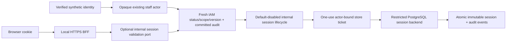

# Nukhbapay local staff HTTPS and server sessions

This is the local, synthetic Brick 3C foundation (ADR 0022), not real Auth0 login or operational staff access. The API stays on `127.0.0.1:3000`. The new BFF uses `https://localhost:3001`, bound only to IPv4 loopback. Browser sign-in remains unavailable. The owner explicitly chose to leave Windows trust unchanged; no CurrentUser Root entry is installed. Strict per-client public-certificate pinning is supported, while browser trust remains unverified. Auth0 resources reported by the owner (US-5 development, RFC 9068, RS256, Always MFA, OTP/recovery) were not contacted or configured by this increment.

## Run the local HTTPS portal

Use the existing pinned pnpm 10.34.9. No additional third-party runtime dependency is required.

```powershell
pnpm.cmd staff:build
powershell.exe -NoProfile -ExecutionPolicy RemoteSigned -File scripts/setup-staff-development-https.ps1 -Action Create
```

The creation script generates a 30-day RSA-3072/SHA-256 localhost-only certificate with CA=false in CurrentUser My. Its fresh directory under `%LOCALAPPDATA%\Nukhbapay\development-https` has user-only ACLs. It exports an encrypted PFX, public certificate, DPAPI-protected passphrase and public metadata there, outside OneDrive. It prints only public metadata. No existing certificate/file/checkpoint is overwritten. Never copy private material or the protected passphrase file into the repository, backup archive or chat.

The default Windows policy can block local scripts. `RemoteSigned` in these commands applies only to that process; do not change persistent machine/user execution policy. Review the public certificate and exact fingerprint before a separate trust action:

```powershell
powershell.exe -NoProfile -ExecutionPolicy RemoteSigned -File scripts/setup-staff-development-https.ps1 -Action Inspect -Thumbprint '<reviewed public thumbprint>'
# Requires explicit approval of this particular CurrentUser trust entry:
powershell.exe -NoProfile -ExecutionPolicy RemoteSigned -File scripts/setup-staff-development-https.ps1 -Action Trust -Thumbprint '<reviewed public thumbprint>'
powershell.exe -NoProfile -ExecutionPolicy RemoteSigned -File scripts/start-staff-portal.ps1 -CertificateMetadata '<absolute metadata.json path>'
```

The normal launcher requires the reviewed trust entry. Because Windows trust was declined for this increment, use the explicit pinned-client-only option instead:

```powershell
powershell.exe -NoProfile -ExecutionPolicy RemoteSigned -File scripts/start-staff-portal.ps1 -CertificateMetadata '<absolute metadata.json path>' -PinnedCertificateOnly
```

This does not disable TLS verification or modify Windows trust. Clients must explicitly trust the exact public certificate; browsers will not be considered trusted, and certificate warnings must not be bypassed. The launcher decrypts the passphrase only into the child process environment and restores its environment afterwards. It does not populate a secret `.env` file. Nothing changes LocalMachine trust. CurrentUser trust applies to that localhost certificate across ports; review expiry/renewal and eventual removal of this exact newly installed entry with the owner. No automatic trust replacement or certificate deletion is performed.

For a future separately approved Windows trust installation, verify normally with no TLS bypass:

```powershell
curl.exe --fail --silent --show-error https://localhost:3001/health/live
```

For the current pinned-client mode, convert only the public DER certificate to PEM using Node X509Certificate and supply that public PEM to curl. No private key/passphrase is involved:

```powershell
node --input-type=module -e "import {readFileSync,writeFileSync} from 'node:fs'; import {X509Certificate} from 'node:crypto'; writeFileSync(process.argv[2],new X509Certificate(readFileSync(process.argv[1])).toString(),{flag:'wx'});" '<public localhost.cer path>' '<new public localhost.pem path>'
curl.exe --noproxy localhost --cacert '<public localhost.pem path>' --fail --silent --show-error https://localhost:3001/health/live
```

The CLI requires `NUKHBAPAY_STAFF_TLS_PFX_PATH`, `NUKHBAPAY_STAFF_TLS_CERT_PATH` and `NUKHBAPAY_STAFF_TLS_PASSPHRASE` supplied by the launcher. `NUKHBAPAY_STAFF_SESSION_MODE` may be absent or `disabled`; other values reject startup. It reads no IAM/importer/migrator/client credentials, creates no database pool and has no environment-selected synthetic/real login provider. Certificate/public key mismatch, wrong hostname, expiry, missing/bad PFX or passphrase fails startup with sanitized errors.

## HTTP and cookie contract

| Method/path | Behavior |
| --- | --- |
| GET `/` | Minimal staff portal; sign-in unavailable |
| GET `/portal.js` | Fixed same-origin browser script; no backend source or tokens |
| GET `/health/live` | Process liveness only |
| GET `/auth/logged-out` | Public landing; does not authenticate or revoke anything |
| GET `/auth/session` | Default 503; internal synthetic composition returns only authenticated=true and a CSRF value after fresh validated/audited session checks |
| POST `/auth/logout` | Exact-origin, session-bound CSRF, empty JSON object; 204/clear-cookie only after committed or already-confirmed revocation |

Other methods, path aliases, source/configuration paths and login/callback/access-token/session-creation paths are absent. Host checking prevents Host-header rebinding. Responses use no-store, strict CSP, nosniff and no-referrer; header/body sizes and request/socket timeouts are finite. No wildcard CORS or browser token vault exists. Root navigation may have Sec-Fetch-Site=none; state changes reject cross-site Fetch Metadata, foreign/missing Origin, malformed/duplicate cookies or CSRF headers and non-JSON bodies. CSRF uses Node's standard HMAC and timing-safe comparison; it is not authentication evidence.

Cookie: `__Host-nukhbapay_staff`, Secure, HttpOnly, SameSite=Strict, Path=/ and no Domain. The earlier unused legacy cookie spelling is corrected in both source and its security assertion. Tokens never appear in HTTP response bodies/logs. Logout clears the same cookie with Max-Age=0. The Strict choice is appropriate while OIDC is absent; do not reuse it blindly for an Auth0 cross-site callback. A future reviewed SDK transaction cookie may need Lax for a GET code callback (or other justified settings for another response mode), with independent state/nonce/PKCE checks.

## Internal lifecycle and trust



Only the trusted test bootstrap wires the optional session port. No HTTP operation constructs an actor or session, accepts actor/tenant/role IDs as authority, or promotes synthetic MFA/approval JSON. Session creation accepts only the existing opaque actor contract and runtime-registered evidence belonging to that exact handle. Actor status, exact issuer/subject, canonical person, tenant membership, staff/membership versions, role/grant digest and grant time transitions are checked freshly. Existing deny-by-default permissions, separate IAM reader/audit-writer roles and `assurance=not-established` are preserved. No sensitive permission or APPLY operation is enabled.

Session credentials are random 32-byte base64url values; the database and in-memory lookup map use only SHA-256 identifiers. Internal credential objects redact JSON/string/debug inspection and expose the value solely to a trusted cookie sink. Server-side records bind the exact actor/identity/scope/version/digest and expiry. The eight-hour absolute and fifteen-minute idle maximums are immutable bounds; effective expiry is also capped by the original verified token (at most five minutes today). Synthetic tests use shorter bounds. A changed context requires a fresh opaque actor and new session generation, not extension of an old credential. Cross-staff/identity/tenant rotation is denied.

Observed authority changes permanently invalidate the known handle and attempt committed session revocation; restoring an old status/version cannot revive it. Dependency failures deny without positive authorization caching. A cold process cannot reconstruct actor authority from database rows; existing cookies fail closed after restart. The local registry has a hard 1,000-entry limit and no operational retention/HA/refresh capability. These are explicit activation blockers, not implicit production session behavior. Bearer-cookie theft/replay while a session is still valid is not claimed to be prevented; HTTPS, HttpOnly, CSRF, short validity, rotation and server revocation mitigate that exposure.

ADR 0023 implements additive database triggers for monotonic staff/membership versions and token cutoffs in the combined candidate rehearsal. Suspension/reinstatement, identity and grant changes cannot restore the old version/cutoff snapshot. Verified token issuance must be strictly later than tokens_valid_after. These safeguards grant no writer authority and are not installed on development; approved deployment and a future atomic privileged executor remain separate gates. Historical 004-only fixtures add only the validity-reader projection and do not establish this full contract.

## Proposed migration 006 and permissions

`packages/database/migrations/006_staff_server_sessions.ts` is the registered migration source (ADR 0024). It verifies and loads the unchanged `packages/database/pending-migrations/006_staff_server_sessions.sql` and additive IAM safeguard sidecar only through the reviewed manifest runner. Registered execution remains limited to fresh verified disposable databases; development stays on its recorded 001–003 history until a separately approved migration operation. Do not run the sidecar directly or apply 004–006 to development/shared targets automatically.

| Object | Purpose |
| --- | --- |
| `nukhbapay_sessions.sessions` | Immutable hash/binding/lifetime/generation records; exact actor+tenant FORCE RLS |
| `nukhbapay_sessions.events` | Immutable fixed creation/use/revocation audit evidence; same forced RLS |
| `nukhabapay.staff_identities_session_binding_uq` | Consistency index for exact staff/issuer/subject FK; no staff data mutation or privilege change |
| Four SECURITY INVOKER trigger functions | Immutability, event validity, complete creation tuple, complete rotation tuple; pg_catalog search_path and no workload/PUBLIC EXECUTE |
| Five triggers | Update/delete rejection, event validation and deferred tuple completeness |

The proposed owner recipe `packages/database/roles/grant_staff_session_backend.sql` accepts only a separately created ephemeral NOSUPERUSER/NOCREATEDB/NOCREATEROLE/NOINHERIT/NOBYPASSRLS role on a verified disposable target. It grants database CONNECT, new-schema USAGE, **27 SELECT columns and 23 INSERT columns** across these two tables. It grants no table-wide rights, UPDATE, DELETE, TRUNCATE, REFERENCES, trigger/function execution, role/schema/DB creation, inherited membership, IAM/catalogue access or session-derived permission. Missing/excess/new-column rights and invalid target configuration reject adapter initialization. The session schema gives existing catalogue/IAM workloads no new rights. ADR 0023 separately grants the IAM reader only SELECT(tokens_valid_after); the migrator remains migration-only. Unknown default grantees reject and roll back the complete candidate.

Application operations use only the dedicated session role; current IAM reads/audits retain their separate restricted credentials. RLS actor/tenant GUCs and database credentials are workload scope, not human proof. Even complete injected database rows cannot authenticate because no opaque in-process actor/session binding exists. The SQL unique index/FKs also reject mismatched canonical identity and tenant membership.

READ COMMITTED operations acquire sorted transaction advisory locks before fresh reads, using one connection/transaction for all session changes and audit events. Deferred constraints reject orphan creation or half-rotation. Immutable revocation and insert-time state checks prevent rolling-touch resurrection. Each operation is a consumed, immutable application ticket with exact hash/actor/scope binding and fresh authority checks. Every transaction commits or rolls back before release; network-failed clients are discarded and late socket errors are handled at the client, not by suppressing process exceptions.

Uncertain create/rotation acknowledgement returns no credential. Revoke uncertainty returns failure until a scoped authoritative database check confirms its immutable revocation event; retry cannot duplicate that event. Current tests include actual backend termination and recovery, plus injected acknowledgement loss after an actual committed operation. Existing wire-level before/during/after-COMMIT acceptance remains part of the regression suite. These tests do not establish database failover/crash/storage-loss or restore behavior. New protected requests after observed revocation deny; in-flight operations may have linearized earlier. Freshness checks are not an atomic privileged execution guarantee.

## Later OIDC seam and remaining gates

The future supported BFF SDK will own Authorization Code + PKCE, one-use state/nonce, exact issuer/client/audience and ID-token validation, server-only tokens and reviewed transaction cookies. It may create a session only after signature/profile verification and current exact pre-enrolled staff resolution. ID tokens never become API access tokens; provider-signed MFA/factor/freshness evidence needs a separate reviewed assurance boundary. No client MFA claim, local session or synthetic proof can establish privileged assurance.

Auth0 callback URLs are **not ready to activate**: GET `/auth/login` and GET `/auth/callback` do not exist, and the CLI has no real-provider mode. The intended future callback remains `https://localhost:3001/auth/callback`, with post-logout landing `https://localhost:3001/auth/logged-out`, only after separate implementation/approval and end-to-end provider acceptance. API audience `https://api.dev.nukhbapay.com/staff` is a reported trust identifier, not a callback/listener address. Production region/residency, operational MFA, privileged keys/recovery, named ownership, persistent IAM/session targets, backup/retention/HA and real staff bootstrap remain management gates. No normal-runtime reserved permissions, accepted approvals, staff mutation or financial activity is authorized here.

## Exact maintained-file change inventory

The before/after hashes are recorded in ../recovery-checkpoints/staff-sessions-changes.json. No maintained path was renamed or deleted.

- MODIFIED: `.env.example`
- MODIFIED: `.gitignore`
- MODIFIED: `ARCHITECTURE.md`
- MODIFIED: `README.md`
- MODIFIED: `apps/admin-web/README.md`
- CREATED: `apps/admin-web/package.json`
- CREATED: `apps/admin-web/src/main.ts`
- CREATED: `apps/admin-web/src/portal.ts`
- CREATED: `apps/admin-web/test/portal.spec.ts`
- CREATED: `apps/admin-web/tsconfig.json`
- CREATED: `apps/admin-web/tsconfig.test.json`
- MODIFIED: `apps/api/package.json`
- MODIFIED: `apps/api/src/modules/identity/staff-browser-security.ts`
- MODIFIED: `apps/api/test/staff-browser-security.spec.ts`
- CREATED: `apps/api/test/staff-sessions.integration.ts`
- CREATED: `docs/adr/0022-local-https-staff-server-sessions.md`
- MODIFIED: `docs/build-sequence.md`
- MODIFIED: `docs/data-model.md`
- MODIFIED: `docs/governance/pending-management-approvals.md`
- MODIFIED: `docs/progress.md`
- MODIFIED: `docs/project-structure.md`
- MODIFIED: `docs/security/requirements.md`
- CREATED: `docs/security/staff-server-sessions.md`
- MODIFIED: `docs/verification.md`
- MODIFIED: `package.json`
- CREATED: `packages/application/src/identity/staff-session.ts`
- MODIFIED: `packages/application/src/identity/trusted-staff-actor.ts`
- MODIFIED: `packages/application/src/index.ts`
- CREATED: `packages/application/test/staff-session.test.ts`
- CREATED: `packages/database/pending-migrations/006_staff_server_sessions.sql`
- CREATED: `packages/database/roles/grant_staff_session_backend.sql`
- MODIFIED: `packages/database/src/index.ts`
- CREATED: `packages/database/src/staff-session-store.ts`
- MODIFIED: `pnpm-lock.yaml`
- MODIFIED: `pnpm-workspace.yaml`
- MODIFIED: `scripts/check_structure.py`
- CREATED: `scripts/setup-staff-development-https.ps1`
- CREATED: `scripts/start-staff-portal.ps1`
